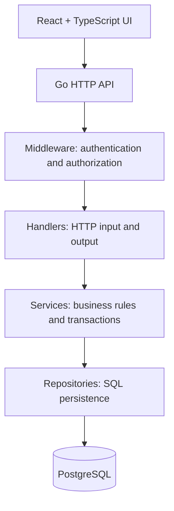

# StockFlow — Inventory & Stock Transaction System

> **Status:** In development. Replace every `[TODO]` with verified project information. Do not claim a feature is complete until it is implemented and tested.

## 1. Overview

StockFlow is a full-stack inventory and stock-movement application built to demonstrate safe inventory workflows, API design, and database consistency. It is intended as a portfolio project for learning how a warehouse-oriented business application works beyond basic CRUD.

**Live demo:** [TODO: URL or “Not deployed yet”]  
**API base URL:** [TODO]  
**Repository:** [TODO]  
**Screenshots:** [TODO: add screenshots under `docs/screenshots/`]

## 2. Business problem

Inventory teams need to know what stock exists, who changed it, and why. A simple form that overwrites a product's stock quantity can make it difficult to reconstruct changes and can cause incorrect results when multiple users update the same item.

StockFlow models stock changes as recorded movements and treats the database as the source of truth. Its central technical requirement is to keep the stock balance and movement history consistent, including when requests happen concurrently.

## 3. Intended industry and users

**Potential contexts:** small warehouses, retail back rooms, spare-parts storage, and internal stockrooms. This is a learning/demo application, not a certified or production-audited inventory product.

- **Admin:** manages products and user access.
- **Staff:** records stock-in and stock-out operations.
- **Manager:** reviews inventory status and movement history.

Adjust these roles to match the actual authorization rules implemented.

## 4. Operational workflow and expected impact

1. An authorized user creates or finds a product by SKU.
2. The user records stock entering or leaving the warehouse.
3. The backend validates the request and applies the stock change in a database transaction.
4. The movement is recorded with the responsible user and timestamp.
5. Staff and managers can review the current balance and movement history.

**Expected operational value:** clearer stock traceability, fewer manual balance-editing mistakes, and a more auditable view of inventory changes. These are intended benefits, not measured results; no real-world savings or accuracy improvement should be claimed without evidence.

## 5. Features

Mark each item as implemented only after it works and has been tested.

- [ ] Product management and unique SKU validation
- [ ] Product search and pagination
- [ ] Stock-in and stock-out transactions
- [ ] Prevent negative stock
- [ ] Safe handling of concurrent stock-out requests
- [ ] Movement history / audit trail
- [ ] Authentication
- [ ] Role-based API authorization
- [ ] Dashboard summaries and low-stock indicator
- [ ] Automated tests
- [ ] Docker-based local environment
- [ ] CI workflow
- [ ] Public demo deployment

## 6. Technology stack

| Layer | Technology | Why it is used |
|---|---|---|
| Frontend | React + TypeScript + Vite | Interactive UI with typed API contracts |
| Styling | Tailwind CSS | Fast, consistent UI implementation |
| Backend | Go + Gin | HTTP API and explicit backend structure |
| Database | PostgreSQL | Relational integrity and transaction support |
| Database driver | pgx | Direct SQL and transaction learning |
| Authentication | [TODO: exact implementation] | Identity and protected API access |
| Testing | Go testing / httptest and frontend tooling | Validate business rules and UI integration |
| Database hosting | Neon (managed PostgreSQL)|
| CI/CD | GitHub Actions, if implemented | Repeatable automated checks |
| Migrations | golang-migrate|

Remove technologies that are not actually used.

## 7. Architecture



The intended request flow is UI → handler → service → repository → PostgreSQL. Handlers deal with HTTP concerns, services coordinate business rules, and repositories own SQL persistence. Update this diagram if the actual implementation differs.

## 8. Repository structure

```text
stockflow/
├── apps/
│   ├── api/
│   │   ├── cmd/api/          # API entry point
│   │   ├── internal/
│   │   │   ├── config/       # Environment configuration
│   │   │   ├── handler/      # HTTP handlers
│   │   │   ├── middleware/   # Cross-cutting HTTP concerns
│   │   │   ├── service/      # Business rules
│   │   │   ├── repository/   # SQL and persistence
│   │   │   └── model/        # Domain/data structures
│   │   ├── migrations/       # Versioned SQL schema changes
│   │   └── tests/            # Integration tests, if used
│   └── web/
│       └── src/
│           ├── pages/        # Route-level pages
│           ├── components/   # Reusable UI
│           ├── services/     # API calls
│           ├── types/        # TypeScript types
│           └── utils/        # Pure helper functions
├── docs/
│   └── screenshots/
├── .github/workflows/        # CI configuration
├── docker-compose.yml
├── .env.example
└── README.md
```

This is the planned layout. Document the actual layout after it is created; do not keep folders that have no purpose.

## 9. Data model

Document the actual schema and constraints here.

| Entity | Purpose | Important rules |
|---|---|---|
| `users` | Application identities and roles | Password hashes only; valid role values |
| `products` | SKU, name, current stock, minimum stock | SKU uniqueness; stock cannot be negative |
| `stock_movements` | Immutable record of stock-in/out | Product, actor, movement type, quantity, timestamp |

**[TODO]** Add an ER diagram and list the real foreign keys, indexes, constraints, and delete behavior after migrations exist.

## 10. Stock consistency and concurrency

The backend must update stock and insert the corresponding movement in the same database transaction. If either operation fails, both must roll back.

For concurrent stock-out operations, document the actual protection used, such as row-level locking with `SELECT ... FOR UPDATE` or a carefully designed conditional update. Explain why it prevents two requests from both consuming the same remaining unit.

**[TODO]** Record the relevant test and its observed result. Do not claim concurrency safety until the test has been run.

## 11. API reference

Document the actual endpoints and authorization rules. Planned examples:

| Method | Path | Purpose |
|---|---|---|
| `POST` | `/api/v1/auth/login` | Authenticate |
| `GET` | `/api/v1/auth/me` | Current identity |
| `GET` | `/api/v1/products` | Search/list products |
| `POST` | `/api/v1/products` | Create product |
| `PATCH` | `/api/v1/products/:id` | Update product |
| `POST` | `/api/v1/stock-movements` | Record stock-in/out |
| `GET` | `/api/v1/stock-movements` | List movement history |
| `GET` | `/api/v1/dashboard` | Dashboard summaries |
| `GET` | `/api/v1/products`  | Implement with parameter search, page, page_size|

Example request (adapt to the actual API contract):

```json
{
  "product_id": 12,
  "type": "OUT",
  "quantity": 1,
  "note": "Issued to production"
}
```

For important endpoints, add successful and failed response examples, status codes, validation behavior, and role requirements.

## 12. Security

Document implemented controls, not intentions alone:

- Password hashing and credential handling.
- API-side authentication and role checks.
- Input validation and consistent errors.
- SQL parameterization.
- CORS configuration appropriate to the deployed frontend.
- Environment-based secrets; never commit real secrets.
- Safe demo accounts and seeded fake data.
- Rate limiting or other controls only if implemented and tested.

## 13. Local development

**Prerequisites:** [TODO: Go version], [TODO: Node.js version], PostgreSQL or Docker.

1. Clone the repository.
2. Copy `.env.example` to `.env` and fill local development values.
3. Start PostgreSQL using the documented method.
4. Apply migrations.
5. Start the Go API.
6. Start the frontend.
7. Sign in using documented local demo credentials, if seeded.

**Commands:** Replace the placeholders with commands verified on a clean setup.

```bash
# TODO: API setup and run commands
# TODO: frontend install and run commands
# TODO: database migration command
```

Never publish real passwords, signing keys, or production connection strings.

## 14. Testing and quality checks

List exact commands and observed results.

- Unit tests for validation and business rules.
- Repository/integration tests for SQL behavior.
- Transaction rollback tests.
- Concurrent stock-out test.
- Authentication and role authorization tests.
- Frontend build and important user-flow checks.
- Tes otomatis mencakup validasi service dan integrasi service-database; lapisan HTTP belum diuji otomatis

**Latest verified result:** [TODO: date, command, pass/fail summary]

## 15. Deployment

**Frontend URL:** [TODO]  
**API URL:** [TODO]  
**Database hosting:** [TODO, no secrets]  
**CI status:** [TODO]

Explain how environment variables, migrations, CORS, health checks, and demo credentials are configured. If no public deployment exists, say so clearly and provide local run instructions.

## 16. How this differs from similar projects

Generic inventory tutorials often focus on CRUD forms and editable quantity fields. StockFlow's intended distinction is to treat stock as a transactional business process: movement history, server-side business rules, concurrency protection, role-aware access, and tests for failure cases.

Compared with full commercial inventory/warehouse management systems, this project has a much smaller scope: it does not claim multi-warehouse planning, procurement automation, barcode operations, accounting integration, forecasting, or enterprise compliance unless those capabilities are later built. It is an educational portfolio project, not a replacement for a mature warehouse platform.

## 17. Trade-offs and limitations

- [TODO: actual limitation]
- [TODO: deliberate MVP trade-off]
- [TODO: known bug or unsupported workflow]
- [trade-off OFFSET dan ILIKE]

Explain why each important trade-off was made and what would be needed to address it.

## 18. Roadmap

- [ ] MVP: products and stock movements
- [ ] Transaction and concurrency tests
- [ ] Authentication and role authorization
- [ ] Dashboard and movement history
- [ ] Deployment and CI
- [ ] Future enhancements only after the MVP is stable

## 19. Screenshots

Add screenshots to `docs/screenshots/` and embed them here. Do not include fake or unrelated screenshots.

## 20. Learning outcomes

Summarize concepts actually implemented and understood: Go project structure, HTTP API design, SQL transactions, concurrency, authorization, automated tests, and full-stack integration.

## 21. License

[TODO: choose a license before publishing.]
